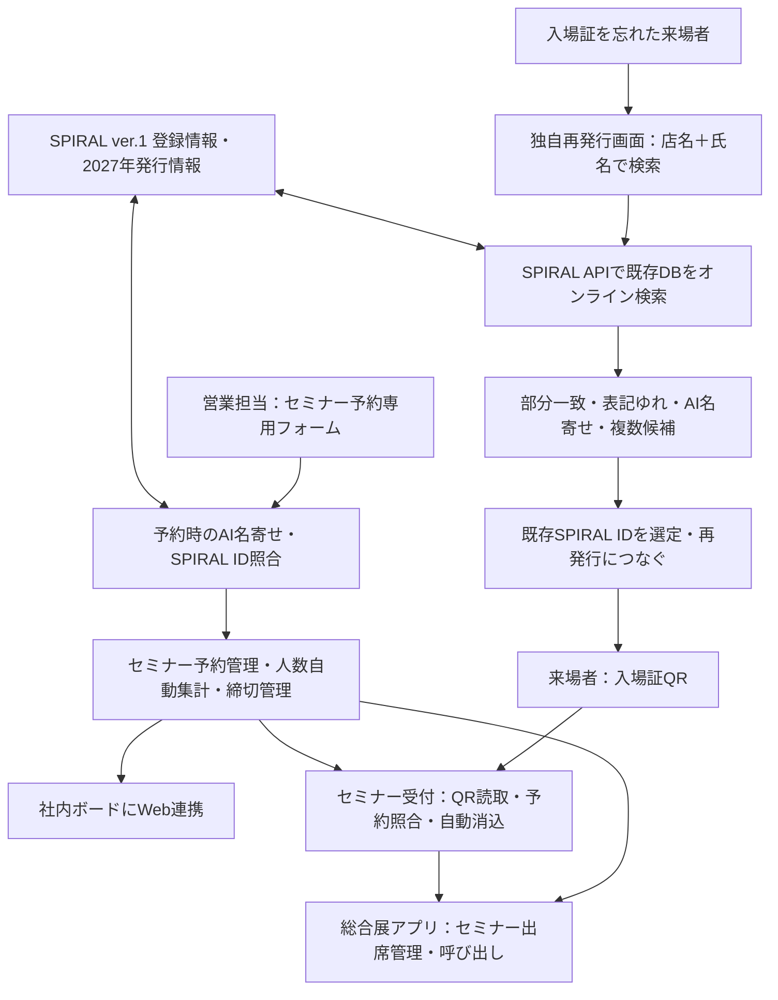
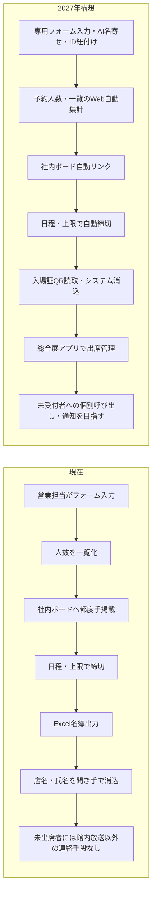
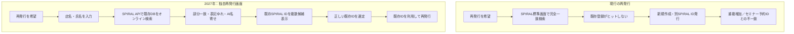
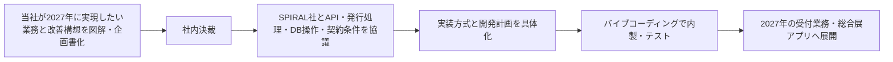

# 総合展2027 システム改修構想 企画書

作成日：2026年10月21日  
位置づけ：当社が2027年に実現したい業務・システム構想を社内およびSPIRAL社へ具体的に伝えるための企画書  
対象：総合展2027、現行の総合展2026アプリ、SPIRAL ver.1、セミナー予約・当日受付・入場証再発行業務

> 本書は当社の要望・現行の問題・改善構想を示す。SPIRAL社へ開発を委託する企画ではなく、SPIRAL APIを使った独自Webシステムの内製を基本方針とする。方式候補は候補のまま併記し、要望を削らない。

---

# 第1章 企画の目的と改修全体像

## 1-1. 企画の目的

総合展2027に向け、2026年の運営を通して明らかになった受付業務の問題を改善する。目指すのは、セミナー予約から定員管理、社内共有、当日QR受付、出席管理、ノーショー防止までを効率化し、さらに入場証再発行時の検索失敗による重複SPIRAL IDの発生を抑制することである。

総合展アプリ本体のリニューアルと、アプリとは直接一体でない受付関連の独自業務システムの開発を並行して検討する。特に①と②は早期に着手する。

| 区分 | 2027年の取組 | 優先度 |
|---|---|---|
| ① | セミナー受付の入場証QR認証連携とQR受付チェック。専用予約フォーム、AI名寄せ、SPIRAL ID紐付け、定員・締切・一覧自動管理、出席管理、ノーショー対策 | 最優先 |
| ② | 入場証再発行専用Web画面の内製。SPIRAL APIによるオンラインDB検索、部分一致・AI名寄せ・複数候補提示、既存SPIRAL IDでの再発行 | 最優先 |
| ③ | **総合展アプリのリニューアル（会場図・セミナー予約管理機能・呼び出し機能）** | 後続。①と連携する部分は並行して検討 |
| ④ | その他改修 | 今後具体化 |

①セミナー予約・受付管理と②入場証再発行は別の業務・別の改修項目である。一方、**同一の来場者に対応する適切なSPIRAL IDを特定して利用すること**は両者の共通課題となる。

## 1-2. 2027年構想を一枚で捉える

ここでの「SPIRAL ID」は入場証QRが参照する個人識別子を指す。総合展アプリ内のセッションIDとは別物であり、混同しない。

## 1-3. 開発と費用の基本方針

- 現行のSPIRALは **ver.1**。既存登録データは**約16,000行**。
- SPIRAL社に個別画面・システム開発を委託すると、**1案件あたり100万～300万円程度**の開発料がかかるという当社の把握がある。
- このため、セミナー予約管理と再発行検索は、**バイブコーディングによる内製の独自Web画面**を基本とする。
- **SPIRAL API**を使用してSPIRALのDBをオンラインで検索し、必要な登録・更新等を扱う構想とする。
- SPIRAL側に高額な画面改修を依頼するのではなく、内製・API連携で大幅な費用抑制と業務改善を狙う。
- SPIRAL社とは、社内で実現したいことを整理した後に、必要なAPI・DB操作・発行方式・費用について協議する。
- 当日受付人員の削減、予約管理の転記廃止、不要IDの増加抑制を成果として目指す。

---

# 第2章 現行のSPIRAL・入場証・セミナー管理と共通問題

## 2-1. システムの現状

入場証管理はSPIRAL、セミナー予約は別管理であり、予約時点で両者が必ずしも紐付いていない。入場証QRはSPIRAL IDと対応している。**QR受付を成立させるには、セミナー予約者側に実際に使う入場証QRと一致するSPIRAL IDを持たせる必要がある。**

予約と入場証の発行順序は一律ではない。予約してから入場証を発行する人もいれば、入場証をすでに発行してからセミナーを予約する人もいる。SPIRALに過去の既存登録があっても、2027年の入場証が未発行の場合がある。

同一の人・同一の店でも、店名の漢字・かな・英語表記、会社・店名の揺れ、氏名表記などの違いによって、複数のSPIRAL IDが登録されていることがある。

## 2-2. SPIRAL IDの重複が生む二つの問題

**① セミナー予約との不一致**：セミナー予約時にID-Aに紐付けたが、後日の入場証発行や再発行ではID-Bが使われると、当日QRが予約者として認識されない。

**② データ重複の拡大**：再発行時に既存登録が検索できず新規登録されると、同一人物にさらに別IDが発生する。重複が増えるほど①のID選定も難しくなる。

架空例：

| ID | 登録店名 | 氏名 | 2027年入場証 |
|---|---|---|---|
| ID-A | パティスリーさくら | 山田太郎 | 未発行 |
| ID-B | ぱてぃすりーサクラ | 山田 太郎 | 未発行 |
| ID-C | Patisserie Sakura | 山田太郎 | 未発行 |

この3件を名寄せで同一人物と推定できても、**後日どのIDで2027年入場証が発行されるか**まで一致させない限り、セミナーQR受付は成立しない。

---

# 第3章 改修① セミナー予約・受付業務のシステム化

## 3-1. 現在のセミナー受付方法（5工程）

### ① 営業担当によるフォーム予約入力
営業担当がフォームからセミナー参加者を入力する。セミナー予約情報とSPIRAL入場証情報は別管理で、入場QRに対応するSPIRAL IDが予約時に自動で整合する仕組みはない。

### ② 人数の一覧化と社内ボードへの手掲載
予約人数を一覧化し、その人数を**社内ボードへ都度、手作業で掲載**する。登録の追加・変更があるたびに担当者の転記・掲載作業が生じる。

### ③ 締め切り
**開催日程と参加者上限**に基づいて申込を締め切る。

### ④ 当日受付用名簿作成
予約名簿から**Excel形式の一覧表を出力**し、当日受付に利用できる名簿を作成する。

### ⑤ 当日受付
受付スタッフが**社名（店名）と名前を聞き、一覧表を見ながら手で消し込む**。

### 現行課題
- 予約人数集計、社内ボードへの掲載、受付名簿作成、当日の消込に手作業がある。
- 受付に人員と作業時間を要する。
- **ノーショー対策が取れない。**
- **参加予定者に館内放送以外の連絡手段がない。**
- セミナー予約と入場証QRのIDが一致していないため、QR受付ができない。
- 後日の入場証発行・再発行で違うIDが使われると、予約との照合がさらに難しくなる。

## 3-2. 2027年に目指す受付方法（各工程）

### ① 専用フォームで営業担当が参加者を入力、同時にAI検索・名寄せ
営業担当が**セミナー予約専用フォーム**に参加者を登録する。入力時点でAI検索を走らせ、店名・氏名等をもとに既存SPIRAL登録を名寄せし、適切なSPIRAL IDを特定してセミナー予約に登録・紐付けすることを目指す。

既存登録が見つからない人、同一人に複数登録がある人、2027年入場証が未発行の人も含め、後述のケース別に処理する。

### ② 人数・一覧をWeb化し社内ボードへ自動リンク
セミナーごとの申込人数と参加者一覧をWeb画面で管理する。**社内ボードへ自動リンク・自動連携**し、従来の人数集計・都度手掲載をなくす。社内の関係者が更新された予約状況を確認できる状態を目指す。

### ③ 日程・参加者上限による自動締切
各セミナーの締切日程、参加者の上限数に達したときに**自動で予約を締め切る**。手動で締切を管理する負担と定員超過のリスクを減らす。

### ④ 総合展アプリのセミナー出席管理によるノーショー対策
総合展アプリに**セミナー予約管理・出席管理機能**を設け、予約した人の受付済み・未受付の状態を管理する。ノーショーを把握し、減らすために活用する。

### ⑤ 当日受付：入場証QRを読み込みシステムで自動消込
受付で**入場証QRを読み取り、SPIRAL IDとセミナー予約を照合し、出席をシステムで消し込む**。紙の名簿で店名・氏名を聞いて人手で探し、手で消込する方式から移行する。

ただし、**QRを持参していない来場者がいる**ため、QRのみを前提にしない。QRあり・QRなしを**同じ受付システム**で処理できる形とする。予約名簿にいない**当日の参加希望者・未登録者**にも対応する。QRを持参していない人の受付は、現行の負担を増やさないよう**店名＋氏名**を基本とする。

### ⑥ まだ来ていない参加予定者への呼び出し・通知
セミナー出席管理で**予約済み・未受付**の参加者を特定し、**総合展アプリから個別通知・呼び出しができないか**を構想に含める。館内放送以外の連絡手段を持ち、ノーショー削減を目指す。

通知の成立には、利用者がアプリを使っているか、通知可能な状態か、SPIRAL IDとアプリ利用者が紐付くか等が関係する。これらは通知方式を設計する際に考慮する。アプリを利用しない参加者まで無条件に通知できるとは記載しない。

## 3-3. 改修前後の業務フロー

## 3-4. セミナー予約と入場証発行の順序による全ケース

セミナー予約にSPIRAL IDを紐付けるうえで、次のケースを省略せず区別する。

### ケース1-A：先にセミナーを予約／SPIRALに既存登録あり
セミナー予約時にSPIRALに既存登録が存在する。**2027年入場証がまだ未発行**の場合がある。登録が1件ならそのIDの利用が候補になるが、複数登録がある場合は単純に1件を採用できない。

**最大の問題：2027年未発行で、同一人に複数SPIRAL IDがある場合。** 名寄せして1件を選んでも、後日に来場者が別の登録からQR入場証を発行すれば予約とQRのIDが一致しない。**人物の名寄せ**だけでなく、**将来発行される入場証のIDと予約IDを一致させる制御**が必要である。

### ケース1-B：先にセミナーを予約／SPIRALに登録がない新規顧客
予約時点ではSPIRAL IDが存在しない。**後日に入場証が発行された際に、そのIDを予約データへ紐付ける**必要がある。単に予約時検索で「該当なし」として終わらせては、当日QR照合ができない。

### ケース2：すでにQR入場証を発行済み／その後にセミナーを予約
**2027年発行フラグあり**のSPIRAL登録を見つけ、発行済みQRと一致するIDをセミナー予約に紐付ける。複数登録がある場合には、2027年発行状況をID選定に用いる。2027年発行済みIDが複数存在することも想定した選定が必要となる。

## 3-5. 最大問題への具体的な解決構想（両案を保持）

### 案①：セミナーフラグをつけ、該当IDで入場証が発行されるようにする
予約登録時に名寄せして使用するSPIRAL IDを選び、**そのIDにセミナーフラグを付与**する。その後2027年入場証を発行する場面で、フラグのついたIDが利用されるようにすることを狙う。

この案の狙いは「予約時に決めたID」と「後日発行されるQRのID」のずれを抑えることであり、複数の既存登録を必ずしも削除しない。

### 案②：セミナー登録時に名寄せし、不要な2IDを削除する
セミナー予約の段階で同一人物の複数登録を名寄せし、たとえば3つのIDがあれば**使用する1IDを残して不要な2IDを削除**し、発行に使われるIDを一本化する。

この案は入場証QRとの不一致と、重複レコードの問題の両方への対処を意図する。削除対象の選定・既存データとの関連を踏まえて運用する必要がある。AIが自動的に断定して削除する運用を勝手に確定しない。

### 組み合わせ
名寄せ・ID選定後にセミナーフラグを付け、重複登録の整理を組み合わせる構想も残す。**セミナーフラグ方式、重複ID削除方式、両者の組み合わせは、当社が検討した要件案としてすべて保持する。**

## 3-6. SPIRAL ID紐付けの実行タイミング（両方式を保持）

**方式A：定期巡回・定期突合**  
セミナー予約者一覧とSPIRALの入場証発行者・登録者データを**定期的に突合**し、予約後に入場証が発行された人を含めてIDを紐付ける。特にケース1-B、ケース1-Aの後日発行への追随に使う。

**方式B：オンライン・予約入力時照合**  
専用フォームに営業担当が入力する時点で、SPIRAL APIを介してDBを照合し、**名寄せ・ID特定・登録をその場で行う**。ケース1-Aの既存登録やケース2の発行済み登録との連携を狙う。

**定期巡回方式でもよく、逆に予約入力時のオンライン紐付けでもよい。** 二者択一を先に決めず、必要に応じて組み合わせることも含めて社内の希望を示す。

## 3-7. 現場運用に関する基本要件

- QRがある人にも、持参しない人にも、同一の受付システムで対応する。
- セミナー予約者とSPIRAL入場証登録は別管理のまま、必要なID照合・連携を行う。
- セミナーの予約が入場証より先でも処理できる。
- 名簿にない来場者、当日申し込む来場者を排除しない。
- 受付の入力負担を増やさない。QRなしの場合も店名と氏名を基本とする。
- 当日の**セミナー受付の受付済み／未受付**を記録し、ノーショーの把握につなげる。
- 入場証QRの読取だけで出席を推定せず、当該セミナーの受付チェックと紐付ける。

---

# 第4章 改修② 入場証再発行専用画面の内製・AI名寄せ検索

## 4-1. 現行業務で起きている問題

現在の入場証再発行者は**約200人**。再発行受付はアルバイトスタッフが対応している。

現行の**SPIRAL標準の再発行画面が完全一致ベース**の検索であるため、既存顧客が登録済みであっても検索ヒット率が低い。アルバイトスタッフではうまく検索できず、**ほとんどが新規作成になっている**という現場課題がある。

SPIRALには既存SPIRAL IDを利用して再発行する仕組みはあるが、**現行の検索画面では該当IDを探し出せない**ことが問題である。

このため：
1. 本来は既存IDで再発行すべき顧客について新しいIDが発行される。
2. 同一人のSPIRALアカウント・登録行数が増え続ける。
3. セミナー予約者のIDと再発行QRのIDが一致しなくなる。
4. 現場のアルバイトスタッフの検索と判断に負担が集中する。

**SPIRAL社へ標準再発行画面の改修を発注するのではない。** SPIRAL社による個別開発は高額であるため、**再発行専用画面を自社で新しく作る**ことがこの改修の中心である。

## 4-2. 目指す再発行専用画面

- **バイブコーディングで独自の再発行用Web画面を開発する。**
- その画面から**SPIRAL ver.1 APIを使い、SPIRALの既存データベースをオンラインで直接検索**する。
- 受付スタッフが聞き取る・入力する内容は、**現在と同じ「店名＋氏名」**を基本とする。現場の入力項目を増やさない。
- これまでの名寄せに関する知見を利用し、**部分一致・表記ゆれ吸収・AI名寄せ**を組み合わせて検索する。
- 既存登録が複数ある場合に**複数候補をヒット・表示**する。
- 候補ごとに氏名・店名・2027年の発行状況・SPIRAL ID等、選定に必要な情報を示し、アルバイトスタッフが既存登録を特定できるようにする。
- 正しい既存IDを使用した**再発行処理につなげる**。既存ID利用を前提とし、再発行のために安易に新規IDを増やさない。

## 4-3. 検索で吸収したい差異

- 店名・会社名の一部分しか入力できない。
- 漢字、ひらがな、カタカナ、英語・ローマ字の差。
- 全角と半角、空白や区切り、表記の揺れ。
- 氏名の空白有無・表記の差。
- 一人に複数の登録がある。
- 現在の検索条件では既存登録が完全一致しない。
- 2027年発行済みIDと、過去に登録した未発行IDが混在する。

単純な「候補を1つ返す検索」ではなく、**既存登録の候補を漏らさず複数見つけ、使うIDを選べる検索**を目指す。

## 4-4. 現行と新方式のフロー

## 4-5. 定量目標「既存再発行率90%以上」

**目標：再発行対象者について、既存SPIRAL IDを正しく特定し、そのIDで再発行できる割合90%以上。**

これは「検索画面に何らかの候補が出た割合」ではない。**正しい既存IDを使用して再発行できた割合**を目標とする。

現行の再発行者約200人に対して、受付スタッフの習熟度に頼らず高い既存ID利用率を実現し、同時に重複新規登録を大幅に抑制する。

登録自体のない真正の新規来場者と、既存登録を見つけられなかった人は区別する。分母や検証方法は実績評価時に整備し、既存登録のない新規顧客まで誤って既存IDに紐付けることを目的としない。

## 4-6. SPIRAL標準画面の改修ではなく内製する意義

現行SPIRAL標準画面には完全一致検索という現場上の制約がある。SPIRAL社への改修委託は高額である。そこで、**既存のSPIRAL DBとIDを利用しながら、その手前の検索・候補選定・再発行支援操作を独自画面に置き換える**。

今回の独自画面は「単なる検索補助ツール」ではなく、**再発行専用の受付画面**として現場で使う構想である。SPIRAL APIとオンライン連携し、既存IDの利用に直結する操作体験を目指す。

---

# 第5章 SPIRAL APIと名寄せの共通活用

## 5-1. SPIRAL IDの位置づけ

①と②の共通項はSPIRAL IDだが、業務目的を混同しない。

| 項目 | ①セミナー予約・受付 | ②再発行専用画面 |
|---|---|---|
| 業務目的 | 予約者と入場証QRのID一致、当日出席消込 | 既存IDの発見とそのIDによる再発行 |
| 入力場面 | 営業担当が予約フォームへ入力／後日定期突合 | アルバイトが店名＋氏名を入力 |
| SPIRAL連携 | 登録照合、ID選定、発行フラグ・セミナーフラグ等の利用 | オンライン登録検索、候補表示、既存ID選定 |
| 名寄せの用途 | 複数IDの中から予約に使うIDを定め、後日発行との一致を図る | 表記差でヒットしない既存登録を見つける |
| 成果 | QRによる予約照合・セミナー受付 | 既存IDでの再発行率90%以上 |

## 5-2. 当社が実現したいAPI連携

- SPIRAL ver.1の現在約16,000行の登録DBを、独自Web画面からオンラインで検索する。
- 既存SPIRAL IDおよび2027年の入場証発行状況を参照する。
- セミナー予約へのID紐付け、名寄せ後のID確定を支援する。
- セミナーフラグの付与や必要な登録情報更新を実現する構想とする。
- 重複IDの整理、不要IDの削除を必要に応じて行える構想を持つ。
- 既存IDを使う再発行に接続する。
- セミナー予約者と入場証発行者の定期突合、または予約時オンライン照合を可能にする。

**検索でヒットしただけでは解決ではない。** 予約、後日発行、再発行を通じて**実際に使われるSPIRAL IDの整合性**が最終的な成果である。

## 5-3. AIを利用する箇所と役割

AIの用途は、表記が違っても同じ登録者の可能性を見つけること、複数の候補を提示すること、現場で探しやすくすることにある。

AIの推定結果を本人の確定事実として扱う設計にはしない。特にID削除・ID統合・発行ID変更のような操作は誤判定の影響が大きいため、候補提示と最終的なID選定・DB変更を区別する。人が判断する操作をどのように置くかは、運用負荷を増やさないことと両立させる。

---

# 第6章 総合展アプリのリニューアル

## 6-1. 改修対象

③の名称は**「総合展アプリのリニューアル（会場図・セミナー予約管理機能・呼び出し機能）」**とする。「会場図のリニューアル」だけに限定しない。

### 会場図のリニューアル
現行の会場MAP、ブース検索、経路表示を基に、2027年の展示会に合わせてリニューアルする。

### セミナー予約・出席管理機能
予約システムと連携し、総合展アプリで予約・出席状況を利用できるようにする。入場QR受付チェックとの接続、受付済み・未受付の管理、ノーショー対策と一体で考える。

### 呼び出し機能
未受付のセミナー予約者へ、館内放送以外に総合展アプリから呼び出し・個別通知できる仕組みを目指す。アプリの利用状態・通知許可等による制約があるため、全予約者に必ず通知が届くと断言しない。

## 6-2. アプリと独立受付システムの関係

**総合展アプリの改修と、①②の業務用独自画面の開発は同じものではない。**

①の予約フォームと管理画面、②の再発行専用画面は受付業務の効率化のために設計し、総合展アプリ側は会場案内、セミナー出席状況、通知・呼び出しなど必要な利用者向け機能を持たせる。

総合展アプリには既存のQR関連機能があるが、その存在だけでセミナー予約情報とのID連携が完了するわけではない。予約名簿とSPIRAL IDの整合が前提である。

## 6-3. 継続的なアプリ改修・GitHub運用の方向性

2026年版を土台として、2027年以降も毎年機能追加・改修する継続的な総合展アプリとして運用する考え方を採る。年度ごとにゼロから作り直すのではなく、Gitの履歴・タグ・開発ブランチを活用しながら継続開発する。

現在のリポジトリ名は `sogoten2026`、独自ドメインは `sogoten.jp`、CNAMEファイルも `sogoten.jp` である。将来的な `sogoten-app` 等への名称変更はアプリの継続運用方針と整合するが、**本企画書の保存自体ではリポジトリ名・CNAME・ドメイン設定を変更しない**。

---

# 第7章 期待効果と省人化

## 7-1. 事前予約業務

| 現状 | 2027年に目指す姿 |
|---|---|
| 営業担当がフォーム入力 | 専用フォームで入力しAI名寄せ・ID紐付け |
| 予約人数の一覧化と手作業による社内ボード掲載 | 予約人数・参加者一覧のWeb管理と自動リンク掲載 |
| 日程・参加者上限を見て締切 | 日程・参加者上限による自動締切 |
| Excel一覧表を当日受付名簿として出力 | システム内で予約・出欠管理 |
| 予約とSPIRAL入場証が非連動 | SPIRAL IDにより入場証QRと予約を連携 |

## 7-2. 当日のセミナー受付・ノーショー対策

| 現状 | 2027年に目指す姿 |
|---|---|
| 社名・店名・氏名を聞き、紙の一覧表で手消込 | 入場証QRを読み、予約照合・システム消込 |
| QRなしの方は名簿の手作業検索 | 同一受付画面で店名＋氏名等から受付 |
| 名簿にいない当日参加者も現場で対処 | 名簿外の参加者も同一システムで処理 |
| 予約者のノーショーへの対策がない | 出席・未受付を管理し対応 |
| 参加予定者への連絡は館内放送が中心 | 総合展アプリからの個別通知・呼び出しを検討 |

## 7-3. 再発行業務

| 現状 | 2027年に目指す姿 |
|---|---|
| SPIRALの完全一致検索ではヒットしにくい | SPIRAL APIと部分一致・名寄せ・AI検索 |
| アルバイトスタッフが既存登録を探し出せない | 複数候補表示で既存IDを見つけやすくする |
| 既存登録があるのに新規作成 | 正しい既存IDで再発行 |
| 重複SPIRAL IDが増加 | 重複の増加を抑制 |
| セミナー予約のIDと再発行IDが一致しない | 予約に使用したIDとの整合性を高める |
| 再発行者は約200人 | 既存ID再発行率90%以上を目標 |

## 7-4. 人員・工数

Excel出力、印刷、予約人数転記、手消込といった作業を自動化・削減し、**セミナー当日受付人数の削減**を狙う。省人化は、単に担当者の作業を別の画面へ移すのではなく、**スタッフが入力する情報を増やさず、検索・照合・消込をシステム化すること**によって実現する。

---

# 第8章 低コスト内製とSPIRAL API料金

## 8-1. 開発方式の比較

| 費目・方式 | 金額・考え方 |
|---|---|
| SPIRAL社に個別開発を委託 | 当社把握：1案件あたり100万～300万円程度 |
| 当社によるバイブコーディング内製 | 外部委託開発料を抑え、社内で専用画面・連携機能を開発 |
| SPIRAL ver.1 API標準枠 | 10リクエスト/分、追加月額0円という料金条件 |
| SPIRAL API 600リクエスト/分 | 月額5,000円（税抜）という料金条件 |

内製開発の狙いは、**1案件100万～300万円規模のSPIRAL社への画面開発委託を回避し、安価なAPIで既存DBにアクセスする**ことである。

## 8-2. API追加費用の試算

| 利用条件 | 追加費用（税抜） |
|---|---:|
| 600回/分・1か月 | 5,000円 |
| **2026年12月～2027年7月：8か月** | **40,000円** |
| **12か月契約** | **60,000円** |

8か月利用でも4万円、年単位でも6万円というAPI利用料の規模は、個別開発委託費100万～300万円と比較して非常に小さい。

ただし、この比較は**API追加利用料と外部委託開発料の比較**である。既存のSPIRAL基本契約、社内開発工数、AIのAPI利用料、ホスティング費用などを0円と断定するものではない。API利用上限や契約月数に応じた費用は契約条件に従う。

約16,000行の現在のSPIRAL登録データを検索することと、600回/分の呼出上限は別の尺度である。再発行ピークや定期巡回での処理量を踏まえ、API枠を選ぶ。

## 8-3. 企画上の費用効果

①②は高額な外部委託を前提とせず、**独自画面とAPI接続を内製することで、低い追加費用で業務の自動化・省人化を進める**。これが今回のシステム改修構想の大きな柱である。

---

# 第9章 社内での企画整理からSPIRAL社との協議まで

## 9-1. 進める順序

**先に当社のやりたいことを社内で明確にする。その後SPIRAL社と交渉・協議する。** SPIRAL社に要件を一から決めてもらうのではなく、当社の改善構想を具体的に示す。

## 9-2. SPIRAL社と共有する当社の実現希望

次の事項は**当社が実現したい機能・方式の内容**として提示する。

1. SPIRAL ver.1 DBを独自Web画面からAPIでオンライン検索すること。
2. 登録データ約16,000行に対して、既存IDと2027年発行状況を参照すること。
3. セミナー専用予約フォームで登録時にAI名寄せ・SPIRAL ID特定を行うこと。
4. セミナー予約と入場証発行者を定期巡回で突合すること、またはオンラインで即時紐付けすること。
5. 予約先行・既存登録あり、予約先行・登録なし、発行先行・2027年発行フラグあり、すべてのケースを扱うこと。
6. 予約先行・既存複数登録・2027年未発行という最難関ケースで、後日の入場証IDを一致させること。
7. セミナーフラグを利用した発行IDの制御を構想すること。
8. セミナー予約段階で名寄せして不要な複数IDを削除・整理する案も含めること。
9. 再発行専用画面を内製し、SPIRAL APIによる検索・候補選定・既存ID再発行につなげること。
10. 既存のSPIRAL標準再発行画面に高額な改修を発注するのではなく、APIを使った独自画面を前提とすること。
11. 600回/分オプションの費用感を活用し、低コストで運用すること。

---

# 第10章 2027年の取組の全体像と成果

## 10-1. 2027年に達成したい姿

**セミナー予約**：営業担当者が専用フォームへ入力すると、AI名寄せでSPIRAL IDを特定・紐付ける。人数・一覧はWebで自動管理し、社内ボードへ自動リンク。日程・定員で自動締切。

**セミナー当日**：入場証QRを読み取り、予約情報とシステム照合して出席を消し込む。QRを持参しない人も同じシステムで店名＋氏名を基に受付する。名簿にいない当日参加者も受け付ける。受付済み・未受付を総合展アプリで管理し、個別呼び出し・通知によるノーショー防止を目指す。

**入場証再発行**：既存のSPIRAL標準画面の完全一致検索に依存せず、内製の再発行専用画面からSPIRAL APIを利用してオンライン検索し、部分一致・表記ゆれ・AI名寄せで複数の候補を出す。受付アルバイトが既存IDを選定し、**既存IDでの再発行率90%以上**を狙う。

**共通するID問題**：名寄せだけで終わらず、セミナー予約時、後日の入場証発行時、再発行時に**同じ顧客について利用するSPIRAL IDの一貫性**を確保する。

**総合展アプリ**：会場図のリニューアルだけでなく、セミナー予約・出席管理、未受付者への呼び出し・通知機能を追加し、毎年改善を続けるアプリへ発展させる。

**費用・人員**：SPIRAL社への100万～300万円/案件の外部開発委託に代えて、内製と低価格のSPIRAL APIを基本とする。予約管理・受付の手作業と必要人員を削減する。

## 10-2. 優先順位

**最優先は①セミナー受付QR連携と②再発行専用画面・AI名寄せ。** この二つの業務は別案件だが、SPIRAL IDの整合を共通する設計上の軸として進める。

③総合展アプリのリニューアル（会場図、セミナー予約管理機能、呼び出し機能）は①の成果と連携しながら進める。④その他の改修は今後追加する。

---

# 結論

総合展2027では、**セミナーの予約から当日QR受付までのデジタル化**と、**入場証再発行専用画面による既存ID検索・再発行率90%以上**を優先して進める。

両案件を成立させる鍵は、SPIRALの複数登録・表記ゆれを名寄せで扱い、**予約・入場証発行・再発行で利用するSPIRAL IDを一致させること**である。特に「セミナー予約が先、既存登録が複数、2027年入場証は未発行」というケースを中心課題とし、**セミナーフラグ方式、重複ID整理・削除方式、定期巡回突合、予約時オンライン照合**の全候補を検討対象として維持する。

SPIRAL標準画面の高額改修を依頼するのではなく、**SPIRAL ver.1 APIを利用する独自の予約・再発行画面をバイブコーディングで内製する**。総合展アプリも会場図・セミナー管理・呼び出し機能を含む継続的なリニューアル対象とする。

当社として実現したい内容をこの企画書で共有し、社内で構想を整理したうえでSPIRAL社との協議へ進む。
